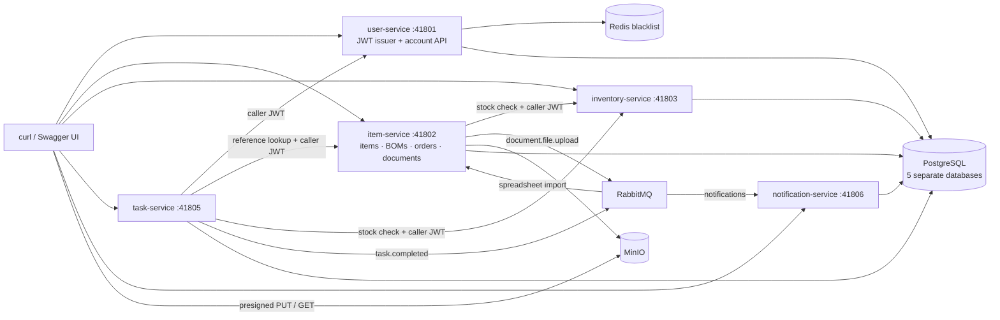
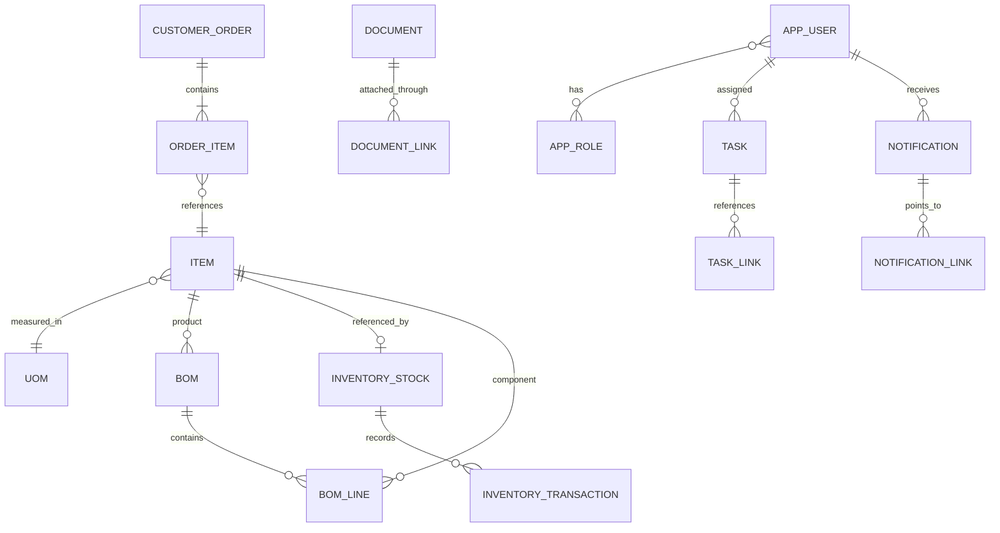

# ERP — manufacturing workflows across five services

[](https://github.com/Ctwqk/ERP/actions/workflows/ci.yml)

A Java 17 / Spring Boot ERP backend connecting bills of materials, stock movements, customer orders, document uploads, and tasks through authenticated HTTP APIs and RabbitMQ events.

Verified locally: **196 tests passed** and **83 full-stack smoke checks passed** ([evidence](docs/verification.md#independent-review-2026-10-19)).

This is a runnable backend portfolio project. It has Swagger UIs, a real local token issuer, database migrations, business-rule tests, and an end-to-end script that exercises all five services. There is no separate frontend.

## What it does

- **Catalog and BOMs:** items and units of measure, component quantities, scrap-adjusted material requirements, and a DRAFT → ACTIVE → OBSOLETE lifecycle. Active component lists are frozen.
- **Inventory:** decimal quantities, first-receipt stock creation, an auditable IN/OUT ledger, and database row locks to prevent concurrent overdrafts.
- **Orders:** SKU/id resolution, integer-cent totals with overflow checks, ownership checks, stock checks on confirmation, and automatic `.xlsx` import from an uploaded ORDER document.
- **Documents:** direct-to-MinIO presigned uploads; completion verifies the stored size before publishing an event. Upload completion and order import belong to the uploader; attaching uploads to an existing order requires its owner.
- **Tasks:** assignee/reference validation through the other services, stock prerequisites, status transitions, and completion events.
- **Notifications:** per-user inboxes consuming document and task events, with deterministic deduplication keys and read/unread state.
- **Users/auth:** administrator bootstrap, BCrypt passwords, ADMIN/HR/USER rules, RSA-signed JWTs, public JWKS, and an auth-service logout blacklist in Redis.

## Architecture



Every service validates the JWT signature, expiry, and issuer. Internal HTTP calls forward the caller's token. Services own separate databases; cross-service IDs are references rather than cross-database foreign keys. `erp-common` holds security, error handling, OpenAPI configuration, and event contracts.

## Domain model



BOM requirements are single-level: `net = product quantity × quantity per component`, `gross = net / (1 − scrap rate)`. Orders and task starts check availability; they **do not reserve or consume stock**. Inventory changes require explicit movements.

## Verified quickstart

Prerequisites: JDK **17 or 21**, Docker Engine with Compose **2.20+** (Compose `include` support), Bash, curl, jq, and Python 3. Maven 3.9.9 is downloaded by the wrapper; an installed Maven 3.9 also works. Allow roughly 6 GiB for the local stack, plus build headroom. No Node installation is needed.

```bash
git clone --branch portfolio-upgrade https://github.com/Ctwqk/ERP.git
cd ERP
cp .env.example .env
./mvnw -B -ntp verify                 # unit tests + real container integration tests; produces all jars
docker compose up -d --build --wait --wait-timeout 180
./scripts/smoke-test.sh
```

Images copy the jars produced by Maven; **rerun Maven before rebuilding images after Java changes**. The root Compose file includes [`docker/docker-compose.yml`](docker/docker-compose.yml). All published ports bind to `127.0.0.1` in the 41000–49999 range; every container has memory/CPU limits and a `pu-erp-` name. `.env.example` contains public, disposable development credentials, not production secrets.

For a disposable demonstration that always tears down containers **and data**, use this instead of the last two commands:

```bash
VERBOSE=1 ./scripts/stack-smoke.sh
```

The wrapper refuses to take over an existing ERP stack or volumes. It starts services sequentially, runs the same HTTP smoke test, and removes its resources even on failure. Verbose transcripts redact passwords, tokens, and presigned URLs.

For an interactive stack, clean up when finished:

```bash
docker compose down                  # retain database/object-store data
# Only when you intend to discard local demo data:
docker compose down --volumes
```

**Shared hosts:** do not run builds or a stack alongside other heavy jobs. On the verification workstation, both Maven and the complete stack-smoke script run under a shared `flock` and a `systemd-run --user --scope` with `MemoryMax=6G` and `MemorySwapMax=0`, after checking at least 8 GiB is available. See [verification evidence](docs/verification.md) for exact commands. JVM heaps are capped at 512 MiB, Maven test forks at one, and Testcontainers instances at 512 MiB each. Docker daemon workloads have their own container limits because a client process scope does not constrain the Docker daemon.

### Local addresses

| Component | URL / port |
| --- | --- |
| Users/auth Swagger | http://localhost:41801/swagger-ui/index.html |
| Items, BOMs, orders, documents Swagger | http://localhost:41802/swagger-ui/index.html |
| Inventory Swagger | http://localhost:41803/swagger-ui/index.html |
| Tasks Swagger | http://localhost:41805/swagger-ui/index.html |
| Notifications Swagger | http://localhost:41806/swagger-ui/index.html |
| RabbitMQ console | http://localhost:41673 |
| MinIO console | http://localhost:41901 |
| MinIO S3 endpoint | http://localhost:41900 |
| PostgreSQL / AMQP | `localhost:41432` / `localhost:41672` |

Each application exposes `/v3/api-docs`, `/actuator/health`, and `/actuator/health/readiness`. The OpenAPI documents and Swagger assets are public; business endpoints require authentication.

## Authenticate and make a request

The first boot creates the administrator from `ERP_ADMIN_EMAIL` and `ERP_ADMIN_PASSWORD` in `.env`; subsequent boots never overwrite an existing account. With the supplied development environment:

```bash
set -a; source .env; set +a
TOKEN=$(curl -fsS http://localhost:41801/auth/login \
  -H 'Content-Type: application/json' \
  -d "$(jq -n --arg email "$ERP_ADMIN_EMAIL" --arg password "$ERP_ADMIN_PASSWORD" \
    '{email:$email,password:$password}')" | jq -er .accessToken)
curl -fsS http://localhost:41802/api/uoms -H "Authorization: Bearer $TOKEN" | jq
```

Paste `TOKEN`'s value into Swagger's **Authorize** dialog (without the `Bearer ` prefix). The JWT's `uid` identifies the account, `sub` is the email, and `roles` contains `ROLE_`-prefixed authorities. `JWT_ISSUER=http://auth-service:8080` is the issuer identifier inside this local stack; browsers do not have to resolve it. Public keys come from user-service's `/.well-known/jwks.json` endpoint.

By default the signing key is generated in memory. Restarting auth replaces the signing key; log in again. Other services may continue accepting old tokens while they retain the previous public key in their JWKS cache. This is a development token issuer, not an OIDC authorization server: there is no authorization-code flow, discovery endpoint, refresh token, or client registration. Logout blacklisting is checked **only by user-service**; other services accept a previously issued token until expiry (default 60 minutes).

For a persistent development key, generate an RSA PKCS12 keystore with `keytool`, mount it read-only into `auth-service` using an ignored `docker-compose.override.yml`, and set `AUTH_KEYSTORE_LOCATION` to the container path plus `AUTH_KEYSTORE_PASSWORD`, `AUTH_KEY_ALIAS`, and optionally `AUTH_KEY_PASSWORD`. The container runs as UID/GID 10001, so the mounted file must be readable by that user. Never commit the keystore, override, or passwords.

## API map

| Service | Main routes | Rules demonstrated |
| --- | --- | --- |
| Users/auth | `POST /auth/login`, `/auth/logout`; `/api/users`, `/api/roles` | account management by ADMIN/HR; ordinary users edit themselves |
| Items | `/api/items`, `/api/uoms`, `/api/boms`, `/api/boms/{id}/requirements?quantity=10` | unique SKUs; valid components and lifecycle; scrap calculation |
| Orders (item-service) | `/api/orders`, `PATCH /api/orders/{id}/status`, `POST /api/orders/{documentId}/import` | owner access, integer-cent totals, live stock checks |
| Documents (item-service) | `/api/documents/{linkId}/images:init`, `images:complete` | two-step upload, file verification, RabbitMQ publication |
| Inventory | `/api/inventory/stocks/{itemId}`, `POST .../{itemId}/transactions` | positive IN/OUT quantities, no negative balances |
| Tasks | `/api/tasks`, `PATCH /api/tasks/{id}/status`, `/{id}/links` | OPEN → IN_PROGRESS → DONE; cancel from OPEN/IN_PROGRESS |
| Notifications | `/api/notifications`, `PATCH /api/notifications/{id}/read` | recipient-only access and event deduplication |

The ledger route is `GET /api/inventory/stocks/{stockId}/transactions`; it uses the **stock row ID**, whereas stock lookup and movement creation use the **item ID**. The document upload paths retain the original `images` naming but accept other file types. ORDER upload `linkId` can be a fresh batch UUID before an order exists; an existing order ID requires the caller to own that order. Raw document metadata create/update/delete endpoints are ADMIN-only; catalog, task, and document reads are shared across authenticated users.

For spreadsheet imports, use columns `item_id`, `sku_code`, `quantity`, `unit_price_cents`, and optional `document_ids`. Supply an item ID or SKU; quantities are positive integers and prices are whole cents. Empty rows are ignored; incomplete rows, malformed IDs, formulas, fractional numbers and numeric overflow reject the entire import. Use text cells for large integer values that Excel cannot represent exactly. The helper creates a real workbook with Python's standard library:

```bash
python3 scripts/make_order_xlsx.py order.xlsx 'BOLT:4:250' 'STEEL:10:15'
```

The smoke script creates catalog records, uploads a workbook to MinIO, and waits for the imported order and notifications. See the [captured request/response transcript](docs/evidence/smoke-transcript.txt).

## Tests and CI

```bash
./mvnw -B -ntp verify                         # complete reactor, Docker required
./mvnw -B -ntp test                           # unit tests only
./mvnw -B -ntp -pl inventory-service -am verify # one service and its shared dependency
```

Surefire runs `*Test`; Failsafe runs `*IT`. Coverage includes inventory arithmetic and concurrent withdrawals, BOM activation/scrap, order totals/ownership/transitions/imports, task prerequisites/transitions, HTTP token forwarding/error handling, JWT/role rules, and notification ownership/deduplication. Integration tests use real PostgreSQL, Redis, RabbitMQ, and MinIO. Some service-level tests substitute downstream HTTP ports; the full-stack smoke test uses all real services and issued tokens.

Testcontainers uses Spring-managed lifecycle cleanup plus its JVM shutdown hook. The auxiliary Ryuk/startup-check containers are disabled so every test container follows the shared-host resource policy. After a hard-killed test JVM, remove only matching `pu-erp-test-*` containers. A Docker daemon on the local machine is expected for the high-loopback-port allocation.

[GitHub Actions](.github/workflows/ci.yml) runs on pushes and pull requests: Java 17 reactor verification, image builds, full-stack smoke, unconditional cleanup, and test-report/transcript artifacts. Local verification, CI, and runtime images use Java 17. The workstation also has a Java 21 runtime, but its Java 17 installation supplies the compiler.

## Layout and technology

```text
pom.xml                     Maven reactor, Java 17, Spring Boot 3.5
├── erp-common/             security, OpenAPI, errors, event contracts, test container policy
├── user-service/           accounts, roles, JWT issuer; PostgreSQL + Redis
├── item-service/           catalog, BOM, order and document packages; MinIO + RabbitMQ
├── inventory-service/      stock and movement ledger
├── task-service/           task workflow, HTTP ports, RabbitMQ producer
├── notification-service/   inbox and RabbitMQ consumers
├── docker/                 Compose and database initialization
├── scripts/                disposable stack, HTTP smoke, XLSX fixture generator
└── docs/                   verification notes and captured evidence
```

Spring Security OAuth2 resource servers · Spring Data JPA/Hibernate · Flyway · PostgreSQL 16 · RabbitMQ · Redis 7 · MinIO · springdoc OpenAPI · Apache POI · JUnit 5/Mockito/Testcontainers.

## Design limits and follow-ups

- This is a local, single-organization demonstration. Catalog, inventory and task endpoints have broad authenticated access; there is no tenant isolation or complete departmental permission model. Documents are shared within that organization, while orders and notifications are private to their users.
- The five databases share one PostgreSQL process and development database credentials. Production would need per-service credentials, TLS, external secrets, backups and operational monitoring.
- Event publication occurs **after database commit**, without a transactional outbox or publisher-confirm recovery. A crash in that gap can lose an event. Consumers retry three times; exhausted messages are discarded, with no dead-letter recovery UI. Add an outbox and dead-letter queues before relying on this operationally.
- Notification deduplication has a database unique key. Spreadsheet imports lock the source document and record a unique source-document ID on the resulting order, so concurrent imports return the same order. Ordinary attachments do not count as import provenance. Inventory movements have row locks; other workflows do not claim full concurrent-update protection.
- Stock checks are advisory, not reservations. BOM explosion is one level with no unit conversions. Manufacturing-order entities are retained but a full production-planning workflow is unfinished.
- Presigned upload URLs remain usable until expiry; completed objects are not immutable. Document deletion spans SQL and object storage without a distributed transaction. Add object versioning, stronger file validation and reconciliation for production use.
- Flyway migrations initialize **fresh databases**. There is no verified upgrade path from legacy hand-created schemas. Earlier demo imports have no reliable source-document record: recreate disposable demo data or reconcile those orders before re-importing old spreadsheets after migration V3.
- The pinned Chainguard MinIO image makes the demo repeatable; update image digests and dependency versions deliberately with the same integration/smoke checks.
- No license has been selected. The owner should choose one before inviting reuse.
